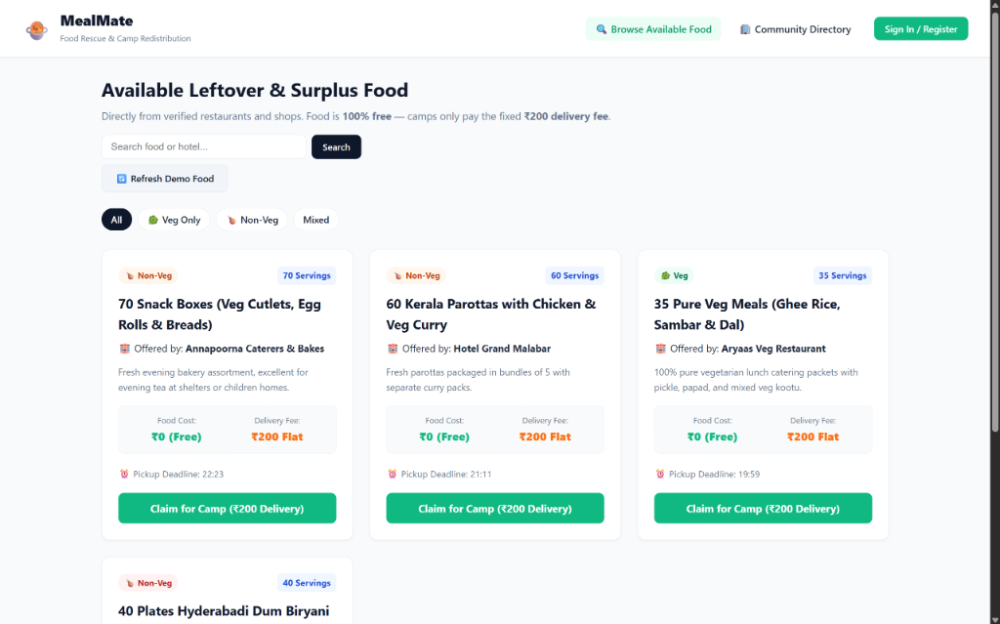

# MealMate

[](https://www.mongodb.com/)
[](https://expressjs.com/)
[](https://react.dev/)
[](https://nodejs.org/)
[](https://vitejs.dev/)
[](https://mealmate-beta.vercel.app/)

> A practical surplus food rescue platform connecting commercial restaurants and caterers with relief camps, orphanages, and old age homes at zero food cost with a flat ₹200 delivery fee.

**Live Application:** [mealmate-beta.vercel.app](https://mealmate-beta.vercel.app/)  
**Source Repository:** [febinsteephen/mealmate](https://github.com/febinsteephen/mealmate)  
**Project Report:** [MealMate_Internship_Report.pdf](MealMate_Internship_Report.pdf)



Commercial food establishments (restaurants, bakeries, caterers) throw away edible leftovers every day, while nearby relief camps, orphanages, and old age homes operate on tight meal budgets. 

MealMate bridges this gap through a simple bilateral exchange:
1. **Food is 100% Free (₹0):** Participating hotels and restaurants list their edible surplus meals at zero item cost.
2. **Flat ₹200 Delivery Fee:** Beneficiary camps only pay a fixed ₹200 logistics charge per batch to cover rider delivery and prevent speculative hoarding.
3. **Name-Based Matching:** Uses clear hotel and camp names for identification without the overhead of real-time GPS coordinates or map APIs.

---

## Tech Stack

- **Frontend:** React 18 (Vite), Axios, Context API, responsive CSS.
- **Backend:** Node.js, Express.js REST API, CORS.
- **Database:** MongoDB Atlas (Cloud M0 Cluster) with Mongoose ODM.
- **Security:** JSON Web Tokens (JWT) for stateless auth, Bcrypt for salted password hashing.
- **Hosting:** Vercel (Client SPA) + Render (Node API Service) + MongoDB Atlas (Cloud Replica Set).

---

## What It Does

### For Hotels & Restaurants (Donors)
- Register and sign in with Hotel/Shop name and contact number.
- Post surplus food batches with servings count, food category (Veg, Non-Veg, Mixed), and claim deadline.
- View posted listings, monitor incoming claims from camps, and update order progress (`Picked Up` $\rightarrow$ `Delivered`).
- Delete uncommitted surplus batches if plans change.

### For Relief Camps, Orphanages & Shelters (Beneficiaries)
- Search and browse available surplus food with active expiry countdowns.
- Filter by category (`Veg Only`, `Non-Veg`, `Mixed`).
- Claim food batches in one click and choose payment mode for the flat ₹200 fee (Online / COD).
- Track order history and delivery milestones in real-time (`Order Placed` $\rightarrow$ `Out for Delivery` $\rightarrow$ `Delivered`).

### Community Directory
- Public searchable registry displaying all verified hotels donating meals and registered welfare institutions (categorized into Disaster Relief Camps, Children's Orphanages, and Senior Care Homes).

### Reviewer Resiliency (Self-Healing Demo Feed)
- The backend automatically checks listing validity. If all sample listings expire or get claimed, it rolls their deadlines forward by 4 to 9 hours so reviewers always encounter active, unexpired food listings with live countdown timers.
- Evaluators can also click **"Refresh Demo Food"** on the browse screen anytime to restore all demo listings in 1 second.

---

## Demo Credentials

All test accounts use the password: **`password123`**

| Role | Account Name | Email | Password |
| :--- | :--- | :--- | :--- |
| **Hotel (Donor)** | Hotel Grand Malabar | `hotel.malabar@example.com` | `password123` |
| **Hotel (Donor)** | Mandhi Manzil | `hotel.mandhimanzil@example.com` | `password123` |
| **Camp (Beneficiary)** | Snehabhavan Orphanage | `camp.snehabhavan@example.com` | `password123` |
| **Camp (Beneficiary)** | Wayanad Relief Camp | `camp.wayanad@example.com` | `password123` |

---

## Running Locally

### Prerequisites
- Node.js (v18 or higher)
- npm (v9 or higher)
- MongoDB running locally or a MongoDB Atlas connection string

### 1. Clone the repository
```bash
git clone https://github.com/febinsteephen/mealmate.git
cd mealmate
```

### 2. Backend Setup
```bash
cd server
npm install

# Create environment file
cp .env.example .env
# Add your MONGODB_URI and JWT_SECRET inside server/.env

# Optional: seed sample hotels, camps, and food listings
npm run seed

# Start server (runs on http://localhost:5000)
npm run dev
```

### 3. Frontend Setup
In a new terminal:
```bash
cd client
npm install

# Create environment file
cp .env.example .env

# Start client (runs on http://localhost:5173)
npm run dev
```

---

## API Endpoints

| Method | Endpoint | Access | Description |
| :--- | :--- | :--- | :--- |
| `POST` | `/api/auth/register` | Public | Register a new Hotel or Camp account |
| `POST` | `/api/auth/login` | Public | Sign in and receive JWT token |
| `GET` | `/api/auth/me` | Private | Fetch logged-in user profile |
| `GET` | `/api/auth/directory` | Public | Get verified hotels and welfare centers |
| `GET` | `/api/listings` | Public | Get active unexpired surplus food |
| `POST` | `/api/listings` | Private (`hotel`) | Publish a surplus food listing |
| `DELETE` | `/api/listings/:id` | Private (`hotel`) | Delete own food listing |
| `POST` | `/api/listings/reset-demo` | Public | Refresh demo food listings |
| `POST` | `/api/orders` | Private (`camp`) | Claim food listing (records flat ₹200 fee) |
| `GET` | `/api/orders/my-camp-orders` | Private (`camp`) | Get claim history for logged-in camp |
| `GET` | `/api/orders/my-hotel-orders` | Private (`hotel`) | Get incoming claims for logged-in hotel |
| `PATCH` | `/api/orders/:id/status` | Private | Update delivery status (`picked_up`, `delivered`) |
| `GET` | `/api/health` | Public | Server health check endpoint |

---

## Project Structure

```text
mealmate/
├── client/                     # React 18 SPA (Vite)
│   ├── src/
│   │   ├── components/         # Navbar, AuthModal
│   │   ├── context/            # AuthContext (JWT & state management)
│   │   ├── pages/              # BrowseFood, Directory, HotelDashboard, Orders
│   │   └── services/           # Axios client with interceptors
│   ├── vite.config.js          # Internal dev proxy to prevent CORS issues
│   └── package.json
├── server/                     # Express Node.js API
│   ├── src/
│   │   ├── config/             # Database connection with auto-retry
│   │   ├── controllers/        # Auth, listing, and order business logic
│   │   ├── middleware/         # JWT verification, RBAC, error handling
│   │   ├── models/             # User, FoodListing, Order schemas
│   │   ├── routes/             # REST API routes
│   │   └── seed.js             # Sample hotels, camps, and food seeder
│   └── package.json
├── MealMate_Internship_Report.pdf  # Official internship project report
├── preview.png                 # Application interface screenshot
└── README.md
```
